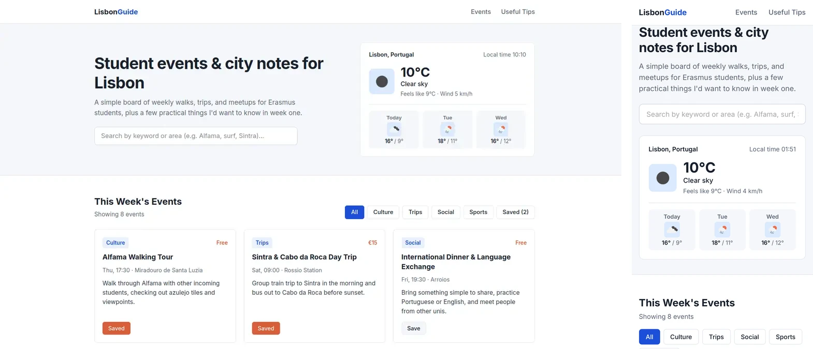

# Erasmus Lisbon City & Events Guide

A mobile-first guide for Erasmus students arriving in Lisbon, with a searchable events board, saved events, live weather, and practical notes for the first week.

**Live Demo:** [Open LisbonGuide](https://ralenaki.github.io/erasmus-lisbon-guide/)

<p align="center">
  
</p>

## Features

- **Browse & filter events:** Explore Culture, Trips, Social, and Sports events, or narrow the list with keyword and neighborhood search.
- **Save events:** Bookmark events in `localStorage` and see the saved count in the filter bar.
- **Live Lisbon weather:** Current conditions and a three-day forecast from Open-Meteo, including local time.
- **Responsive layout:** A two-column introduction on desktop that stacks naturally on smaller screens.
- **Accessible controls:** Keyboard focus styles, labeled search, filter button states, and event updates announced to assistive technologies.

## Built With

- HTML5
- CSS3 (Grid, Flexbox, custom properties)
- Vanilla JavaScript
- [Open-Meteo API](https://open-meteo.com/)

## Run Locally

Clone the repository and open `index.html` in your browser. No build step or API key is needed. The weather card requests data from Open-Meteo, so it needs an internet connection.

## Project Structure

```text
├── assets/
│   ├── desktop_preview.webp
│   ├── mobile_preview.webp
│   └── readme_preview.webp
├── index.html
├── script.js
├── style.css
└── README.md
```

## Next Steps

- Move the sample event listings to a JSON endpoint or CMS so they can be maintained independently.
- Add a Lisbon neighborhood map for event locations.

> Event listings are sample content for the demo, not verified live event schedules.
